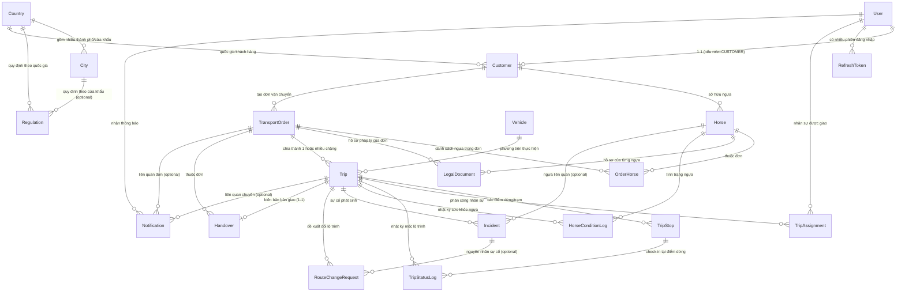

# Tài liệu Entity & Quan hệ Dữ liệu — UmaStar

Tài liệu này giải thích **quan hệ giữa các Entity** và **công dụng của từng thuộc tính** trong hệ thống **Quản lý Vận chuyển Ngựa đua Xuyên Quốc gia (UmaStar)**.

> **Ghi chú chung (`BaseEntity`):**
> Tất cả 20 entity còn lại đều kế thừa từ `BaseEntity`, nên mặc định đều có 3 cột:
> - `id` (`UUID`, khóa chính): Định danh duy nhất tự sinh (`GenerationType.UUID`).
> - `created_at` (`Instant`): Thời điểm tạo bản ghi (tự động gán).
> - `updated_at` (`Instant`): Thời điểm cập nhật bản ghi gần nhất (tự động cập nhật).

---

## 1. Sơ đồ quan hệ tổng quan

---

## 2. Nhóm Tài khoản & Khách hàng

### `User` (Bảng `users`)
Lưu tài khoản đăng nhập cho toàn bộ actor trong hệ thống (`LOGISTICS_MANAGER`, `TRANSPORT_SPECIALIST`, `FLEET_COORDINATOR`, `DRIVER`, `ESCORT`, `CUSTOMER`).
- `fullName` (`full_name`): Họ và tên người dùng.
- `email`: Email đăng nhập (duy nhất).
- `phone`: Số điện thoại liên hệ.
- `passwordHash` (`password_hash`): Mật khẩu đã băm (không lưu plain text).
- `role` (`Role`): Vai trò quyết định quyền hạn.
- `status` (`UserStatus`): Trạng thái tài khoản (`ACTIVE`, `INACTIVE`, `LOCKED`).
- `emailVerified` (`email_verified`): Đã xác thực email hay chưa.
- `failedLoginAttempts` (`failed_login_attempts`): Số lần đăng nhập sai liên tiếp (phục vụ khóa tạm).
- `lockedUntil` (`locked_until`): Thời điểm hết hạn khóa tài khoản.
- `lastLoginAt` (`last_login_at`): Lần đăng nhập thành công gần nhất.
- `passwordChangedAt` (`password_changed_at`): Thời điểm đổi mật khẩu gần nhất (hỗ trợ vô hiệu hóa token cũ).
- `resetTokenHash` (`reset_token_hash`): Mã băm SHA-256 của token đặt lại mật khẩu dùng 1 lần (`null` khi chưa yêu cầu hoặc đã dùng xong).
- `resetTokenExpiresAt` (`reset_token_expires_at`): Thời điểm hết hạn của reset token.
- `resetRequestedAt` (`reset_requested_at`): Thời điểm gửi yêu cầu quên mật khẩu gần nhất (hỗ trợ giới hạn tần suất gửi).

### `Customer` (Bảng `customers`)
Hồ sơ pháp nhân/tổ chức của khách hàng. Quan hệ **1-1** với `User` (`user_id` unique) và **N-1** với `Country`.
- `user`: Tài khoản đăng nhập tương ứng (`users.id`).
- `organizationName` (`organization_name`): Tên CLB, trại ngựa hoặc tên cá nhân chủ ngựa.
- `customerType` (`customer_type`, `CustomerType`): Phân loại `CLUB` (Câu lạc bộ) hoặc `INDIVIDUAL` (Cá nhân).
- `taxCode` (`tax_code`): Mã số thuế / mã đăng ký doanh nghiệp.
- `address`: Địa chỉ liên hệ/trụ sở.
- `country`: Quốc gia của khách hàng.

### `RefreshToken` (Bảng `refresh_tokens`)
Quản lý Refresh Token theo cơ chế rotation (lưu SHA-256 hash). Quan hệ **N-1** với `User`.
- `user`: Chủ sở hữu token.
- `tokenHash` (`token_hash`): Mã băm SHA-256 của refresh token (duy nhất).
- `familyId` (`family_id`): Mã nhóm phiên đăng nhập; nếu token đã thu hồi bị dùng lại, thu hồi toàn bộ `familyId`.
- `expiresAt` (`expires_at`): Thời điểm hết hạn.
- `revoked`, `revokedAt`, `revokedReason`: Đánh dấu đã thu hồi, thời điểm và lý do.
- `replacedByTokenId` (`replaced_by_token_id`): ID token mới thay thế khi xoay vòng.
- `deviceInfo`, `userAgent`, `ipAddress`: Thông tin thiết bị và IP đăng nhập.
- `lastUsedAt` (`last_used_at`): Lần sử dụng gần nhất.

---

## 3. Nhóm Danh mục Địa lý & Quy định

### `Country` (Bảng `countries`)
Danh mục quốc gia phục vụ phân biệt đơn nội địa và quốc tế. Quan hệ **1-N** với `City`.
- `isoCode` (`iso_code`): Mã ISO 2 ký tự (VD: `VN`, `JP`, `AE`).
- `name`, `nameVi` (`name_vi`): Tên tiếng Anh và tiếng Việt.
- `homeCountry` (`home_country`): `true` nếu là nước sở tại (dùng cho đơn `DOMESTIC`).
- `partner`: `true` nếu là quốc gia đối tác đã hỗ trợ vận chuyển quốc tế (`INTERNATIONAL`).
- `active`: Quốc gia có đang hoạt động hay không.
- `cities`: Danh sách thành phố/điểm nút thuộc quốc gia này.

### `City` (Bảng `cities`)
Danh mục thành phố/tỉnh/sân bay/cửa khẩu. Quan hệ **N-1** với `Country` (unique theo cặp `country_id + name`).
- `country`: Quốc gia chứa thành phố.
- `name`, `nameVi` (`name_vi`): Tên thành phố tiếng Anh và tiếng Việt.
- `region`: Tỉnh / bang / vùng (tùy chọn).
- `timezone`: Múi giờ IANA (VD: `Asia/Ho_Chi_Minh`, `Asia/Tokyo`) để quy đổi hiển thị giờ địa phương.
- `hasAirport` (`has_airport`): Đánh dấu thành phố có sân bay vận chuyển ngựa.
- `active`: Trạng thái sử dụng.

### `Regulation` (Bảng `regulations`)
Danh mục quy định y tế, kiểm dịch và hải quan do Transport Specialist quản lý. Quan hệ **N-1** với `Country`, **N-1** (tùy chọn) với `City` và `User` (`updatedBy`).
- `country`: Quốc gia áp dụng quy định.
- `city`: Thành phố / cửa khẩu / sân bay cụ thể (tùy chọn; `null` nếu áp dụng chung cả nước).
- `checkpointName` (`checkpoint_name`): Tên cửa khẩu / trạm kiểm dịch / sân bay.
- `requirementType` (`requirement_type`, `RequirementType`): Loại quy định (`HEALTH`, `QUARANTINE`, `CUSTOMS`).
- `description`: Nội dung chi tiết quy định.
- `requiredDocTypes` (`required_doc_types`): Tập hợp các loại giấy tờ bắt buộc (`DocType`), lưu gọn trong 1 cột của `regulations` qua `DocTypeSetConverter`.
- `quarantineDays` (`quarantine_days`): Số ngày cách ly kiểm dịch bắt buộc (nếu có).
- `effectiveDate` (`effective_date`): Ngày quy định bắt đầu có hiệu lực.
- `active`: Quy định còn hiệu lực hay không.
- `updatedBy` (`updated_by`): Chuyên viên cập nhật gần nhất.

---

## 4. Nhóm Ngựa, Đơn vận chuyển & Hồ sơ Pháp lý

### `Horse` (Bảng `horses`)
Hồ sơ ngựa đua thuộc sở hữu của khách hàng. Quan hệ **N-1** với `Customer`.
- `customer`: Chủ sở hữu / CLB quản lý ngựa.
- `name`: Tên ngựa.
- `microchipNo` (`microchip_no`): Mã microchip gắn trên ngựa (duy nhất toàn hệ thống).
- `passportNo` (`passport_no`): Số hộ chiếu ngựa quốc tế.
- `breed`: Giống ngựa (VD: Thoroughbred).
- `sex` (`HorseSex`): Giới tính (`STALLION`, `MARE`, `GELDING`, `COLT`, `FILLY`).
- `birthDate` (`birth_date`): Ngày sinh.
- `color`: Màu lông.
- `weightKg` (`weight_kg`): Cân nặng (kg) để tính tải trọng phương tiện/khoang bay.
- `healthNotes` (`health_notes`): Ghi chú tiền sử bệnh lý, dị ứng, chế độ chăm sóc.

### `TransportOrder` (Bảng `transport_orders`)
Đơn yêu cầu vận chuyển do Customer tạo và Logistics Manager phê duyệt. Quan hệ **N-1** với `Customer`, `Country`/`City` (điểm đi và điểm đến), `User` (`approvedBy`); **1-N** với `OrderHorse`.
- `orderCode` (`order_code`): Mã đơn hiển thị cho người dùng (duy nhất).
- `customer`: Khách hàng đặt đơn.
- `originCountry`, `originCity`, `originAddress`: Quốc gia, thành phố và địa chỉ cụ thể nơi đón ngựa.
- `destCountry`, `destCity`, `destAddress`: Quốc gia, thành phố và địa chỉ cụ thể nơi giao ngựa.
- `transportType` (`transport_type`, `TransportType`): `DOMESTIC` (nội địa) hoặc `INTERNATIONAL` (quốc tế).
- `requestedDeparture`, `requestedArrival`: Thời gian khởi hành mong muốn và dự kiến cần đến.
- `horseCount` (`horse_count`): Số lượng ngựa vận chuyển.
- `specialRequirements` (`special_requirements`): Yêu cầu đặc biệt (nhiệt độ, thức ăn, bác sĩ thú y đi kèm...).
- `quotedPrice` (`quoted_price`): Giá báo cho khách hàng.
- `actualCost` (`actual_cost`): Chi phí vận hành thực tế (bao gồm chi phí phát sinh).
- `currency`: Đơn vị tiền tệ 3 ký tự (mặc định `USD`).
- `status` (`OrderStatus`): Vòng đời đơn (`PENDING` -> `APPROVED`/`REJECTED` -> `DOC_PROCESSING` -> `READY` -> `IN_TRANSIT` -> `DELIVERED` -> `COMPLETED` / `CANCELLED`).
- `rejectReason`, `approvedBy`, `approvedAt`: Lý do từ chối hoặc thông tin người/thời điểm duyệt đơn.
- `orderHorses`: Danh sách ngựa tham gia đơn hàng.
- `version`: Số phiên bản Optimistic Locking (`@Version`) chống ghi đè đồng thời.

### `OrderHorse` (Bảng `order_horses`)
Bảng trung gian N-N giữa `TransportOrder` và `Horse` (unique theo `order_id + horse_id`).
- `order`: Đơn vận chuyển.
- `horse`: Con ngựa được vận chuyển.
- `stallNumber` (`stall_number`): Số ngăn / số chuồng dự kiến trên phương tiện.
- `specialNote` (`special_note`): Lưu ý riêng cho từng con ngựa trong đơn này.

### `LegalDocument` (Bảng `legal_documents`)
Hồ sơ pháp lý số hóa cho **từng con ngựa trong từng đơn hàng**. Quan hệ **N-1** với `TransportOrder`, `Horse`, `User` (`uploadedBy`, `verifiedBy`).
- `order`, `horse`: Đơn hàng và con ngựa tương ứng của giấy tờ.
- `docType` (`doc_type`, `DocType`): Loại giấy tờ (`VACCINATION_CERT`, `HORSE_PASSPORT`, `EXPORT_PERMIT`, `IMPORT_PERMIT`, `HEALTH_CERT`, `OTHER`).
- `docTypeOther` (`doc_type_other`): Tên loại giấy tờ khi `docType = OTHER`.
- `docNumber` (`doc_number`): Số hiệu văn bản / chứng từ.
- `fileUrl` (`file_url`): Đường dẫn file scan/PDF đã tải lên.
- `issueDate`, `expiryDate`: Ngày cấp và ngày hết hạn.
- `uploadedBy`, `verifiedBy`: Người tải lên (Customer/Specialist) và chuyên viên thẩm định.
- `agency` (`IssuingAgency`): Cơ quan cấp/duyệt (`MINISTRY_OF_AGRICULTURE`, `CUSTOMS`, `QUARANTINE_UNIT`).
- `agencyRefNo` (`agency_ref_no`): Mã hồ sơ tham chiếu tại cơ quan chức năng.
- `approvalStatus` (`approval_status`, `ApprovalStatus`): Tiến độ (`MISSING`, `SUBMITTED`, `UNDER_REVIEW`, `APPROVED`, `REJECTED`).
- `rejectReason` (`reject_reason`): Lý do bị từ chối để khách hàng bổ sung lại.
- `submittedAt`, `approvedAt`: Mốc thời gian nộp và được duyệt.
- `version`: Số phiên bản Optimistic Locking (`@Version`) chống ghi đè đồng thời.

---

## 5. Nhóm Phương tiện, Chuyến đi & Điều phối

### `Vehicle` (Bảng `vehicles`)
Danh mục phương tiện / thiết bị chuyên dụng chở ngựa.
- `vehicleType` (`vehicle_type`, `VehicleType`): `HORSE_TRUCK` (xe tải chở ngựa), `AIR_STALL` (khoang máy bay), `CRATE` (thùng vận chuyển).
- `codeOrPlate` (`code_or_plate`): Biển số xe hoặc mã hiệu khoang/thùng (duy nhất).
- `capacityHorses` (`capacity_horses`): Sức chứa tối đa (số ngựa).
- `carrierName` (`carrier_name`): Tên nhà xe hoặc hãng hàng không sở hữu/khai thác.
- `status` (`VehicleStatus`): Tình trạng (`AVAILABLE`, `IN_USE`, `MAINTENANCE`).
- `version`: Số phiên bản Optimistic Locking (`@Version`) chống ghi đè đồng thời.

### `Trip` (Bảng `trips`)
Một chặng vận chuyển thực tế thuộc `TransportOrder` (một đơn quốc tế có thể gồm nhiều `Trip` theo thứ tự `sequenceNo`). Quan hệ **N-1** với `TransportOrder`, `Vehicle`, `User` (`plannedBy`, `coordinator`); **1-N** với `TripStop`, `TripAssignment`.
- `order`: Đơn vận chuyển gốc.
- `vehicle`: Phương tiện sử dụng cho chặng này.
- `sequenceNo` (`sequence_no`): Thứ tự chặng (mặc định `1`).
- `flightNumber` (`flight_number`): Số hiệu chuyến bay (nếu là chặng hàng không).
- `plannedStart`, `plannedEnd`: Thời gian bắt đầu và kết thúc dự kiến (cơ sở tính On-time delivery).
- `actualStart`, `actualEnd`: Thời gian bắt đầu và kết thúc thực tế.
- `status` (`TripStatus`): `PLANNED`, `DEPARTED`, `IN_TRANSIT`, `DELIVERED`, `CANCELLED`.
- `confirmed`, `confirmedAt`: Cờ xác nhận kế hoạch chuyến đi đã sẵn sàng xuất phát (`POST /trips/{id}/confirm`) và thời điểm xác nhận.
- `plannedBy` (`planned_by`): Người lập kế hoạch (Logistics Manager).
- `coordinator`: Điều phối viên phụ trách chính.
- `currentLat`, `currentLng`, `lastLocationAt`: Tọa độ GPS mới nhất và thời điểm cập nhật vị trí.
- `stops`: Danh sách điểm dừng sắp theo `sequenceNo ASC`.
- `assignments`: Danh sách nhân sự được phân công.
- `version`: Số phiên bản Optimistic Locking (`@Version`) chống ghi đè đồng thời.

### `TripStop` (Bảng `trip_stops`)
Các điểm mốc trên lộ trình của một `Trip` (unique theo `trip_id + sequence_no`). Quan hệ **N-1** với `Trip` và `City`.
- `trip`: Chuyến đi chứa điểm dừng.
- `sequenceNo` (`sequence_no`): Thứ tự điểm dừng trên lộ trình.
- `stopType` (`stop_type`, `StopType`): `ORIGIN`, `REST`, `QUARANTINE`, `FUEL`, `CUSTOMS`, `TRANSIT`, `DESTINATION`, `OTHER`.
- `customTypeName` (`custom_type_name`): Tên loại điểm dừng tự nhập khi `stopType = OTHER`.
- `locationName` (`location_name`): Tên địa điểm cụ thể (trạm dừng, cửa khẩu, sân bay...).
- `city`: Thành phố tương ứng (tùy chọn).
- `latitude`, `longitude`: Tọa độ điểm dừng.
- `plannedArrival`, `actualArrival`: Giờ đến dự kiến và thực tế.
- `plannedDeparture`, `actualDeparture`: Giờ rời dự kiến và thực tế.
- `status` (`StopStatus`): `PENDING`, `ARRIVED`, `CLEARED`, `SKIPPED`.

### `TripAssignment` (Bảng `trip_assignments`)
Phân công nhân sự thực hiện chuyến đi (unique theo `trip_id + user_id + assignment_role`). Quan hệ **N-1** với `Trip`, `User` (`user`, `assignedBy`).
- `trip`: Chuyến đi được phân công.
- `user`: Nhân sự được giao việc.
- `assignmentRole` (`assignment_role`, `AssignmentRole`): Vai trò trong chuyến (`DRIVER`, `ESCORT`, `SPECIALIST`, `COORDINATOR`).
- `assignedBy` (`assigned_by`): Người phân công.
- `assignedAt` (`assigned_at`): Thời điểm phân công.

---

## 6. Nhóm Theo dõi Lộ trình, Sự cố, Bàn giao & Thông báo

### `TripStatusLog` (Bảng `trip_status_logs`)
Nhật ký cập nhật tiến độ chuyến đi tại từng mốc. Quan hệ **N-1** với `Trip`, `TripStop` (tùy chọn), `User` (`reportedBy`).
- `trip`: Chuyến đi.
- `stop`: Điểm dừng liên quan (nếu cập nhật tại điểm dừng).
- `status` (`TripLogStatus`): Mốc sự kiện (`DEPARTED`, `ARRIVED_STOP`, `CUSTOMS_CLEARED`, `DELIVERED`).
- `reportedBy` (`reported_by`): Tài xế / Escort / Điều phối viên báo cáo.
- `reportedAt` (`reported_at`): Thời điểm báo cáo.
- `latitude`, `longitude`: Tọa độ lúc báo cáo.
- `manual` (`is_manual`): `true` nếu cập nhật thủ công, `false` nếu tự động từ GPS/hệ thống.
- `photoUrl` (`photo_url`): Ảnh minh chứng tại mốc (VD: biên bản thông quan).
- `note`: Ghi chú thêm.

### `HorseConditionLog` (Bảng `horse_condition_logs`)
Nhật ký sức khỏe từng con ngựa trong suốt chuyến đi. Quan hệ **N-1** với `Trip`, `Horse`, `User` (`recordedBy`).
- `trip`, `horse`: Chuyến đi và con ngựa được theo dõi.
- `condition` (`horse_condition`, `HorseCondition`): Trạng thái (`STABLE`, `NOT_EATING`, `STRESSED`, `CLIMATE_CHANGE`).
- `note`: Mô tả chi tiết của tài xế/nhân viên đi kèm.
- `photoUrls` (`horse_condition_photos`): Danh sách URL ảnh tình trạng ngựa (tối đa 5 ảnh).
- `recordedBy` (`recorded_by`), `recordedAt` (`recorded_at`): Người ghi nhận và thời điểm.

### `Incident` (Bảng `incidents`)
Báo cáo sự cố khẩn cấp trên đường. Quan hệ **N-1** với `Trip`, `Horse` (tùy chọn), `User` (`reportedBy`, `resolvedBy`).
- `trip`: Chuyến đi gặp sự cố.
- `horse`: Con ngựa bị ảnh hưởng (nếu là sự cố y tế của ngựa; có thể `null`).
- `incidentType` (`incident_type`, `IncidentType`): `VEHICLE_BREAKDOWN`, `TRAFFIC_JAM`, `HORSE_MEDICAL`, `BAD_WEATHER`, `BORDER_CONGESTION`.
- `severity` (`Severity`): Mức độ (`LOW`, `MEDIUM`, `HIGH`, `CRITICAL`).
- `description`: Mô tả sự cố.
- `photoUrl` (`photo_url`): Ảnh hiện trường.
- `latitude`, `longitude`: Vị trí xảy ra sự cố.
- `reportedBy` (`reported_by`), `reportedAt` (`reported_at`): Người báo cáo và thời điểm.
- `status` (`IncidentStatus`): `OPEN`, `HANDLING`, `RESOLVED`.
- `resolvedBy` (`resolved_by`), `resolvedAt` (`resolved_at`), `resolutionNote` (`resolution_note`): Người xử lý, thời điểm và ghi chú cách giải quyết.

### `RouteChangeRequest` (Bảng `route_change_requests`)
Đề xuất đổi lộ trình / chi phí phát sinh do Coordinator tạo khi có sự cố để Logistics Manager phê duyệt. Quan hệ **N-1** với `Trip`, `Incident` (tùy chọn), `User` (`requestedBy`, `approvedBy`).
- `trip`: Chuyến đi cần điều chỉnh.
- `incident`: Sự cố dẫn đến yêu cầu đổi lộ trình (tùy chọn).
- `reason`: Lý do thay đổi.
- `oldRouteSummary` (`old_route_summary`), `newRouteSummary` (`new_route_summary`): Tóm tắt lộ trình cũ và phương án mới.
- `extraCost` (`extra_cost`): Chi phí phát sinh dự kiến.
- `newEta` (`new_eta`): Thời gian dự kiến đến mới.
- `requestedBy` (`requested_by`): Điều phối viên gửi đề xuất.
- `status` (`ChangeRequestStatus`): `PENDING`, `APPROVED`, `REJECTED`.
- `approvedBy` (`approved_by`), `decidedAt` (`decided_at`), `decisionNote` (`decision_note`): Người duyệt, thời điểm quyết định và ghi chú.

### `Handover` (Bảng `handovers`)
Biên bản bàn giao & nghiệm thu chuyến đi. Quan hệ **1-1** với `Trip` (`trip_id` unique) và **N-1** với `TransportOrder`, `User` (`handedOverBy`).
- `trip`, `order`: Chuyến đi và đơn hàng được bàn giao.
- `receiverName` (`receiver_name`), `receiverPhone` (`receiver_phone`): Họ tên và SĐT người nhận ngựa.
- `handoverLocation` (`handover_location`): Địa điểm bàn giao thực tế.
- `horseConditionOnArrival` (`horse_condition_on_arrival`): Ghi nhận tình trạng ngựa khi tới nơi.
- `signatureUrl` (`signature_url`), `photoUrl` (`photo_url`): Ảnh chữ ký xác nhận và ảnh bàn giao.
- `handedOverBy` (`handed_over_by`), `handedOverAt` (`handed_over_at`): Nhân sự bàn giao và thời điểm bàn giao.
- `confirmedByCustomer` (`confirmed_by_customer`), `confirmedAt` (`confirmed_at`): Khách hàng xác nhận đã nhận an toàn.
- `rating`, `feedback`: Điểm đánh giá và nhận xét dịch vụ.

### `Notification` (Bảng `notifications`)
Thông báo gửi tới người dùng (nhắc bổ sung hồ sơ, cập nhật trạng thái, cảnh báo sự cố, thông quan, bàn giao). Quan hệ **N-1** với `User`, `TransportOrder` (tùy chọn), `Trip` (tùy chọn).
- `user`: Người nhận thông báo.
- `order`, `trip`: Đơn hàng / chuyến đi liên quan.
- `type` (`notification_type`, `NotificationType`): `DOC_REQUIRED`, `STATUS_UPDATE`, `INCIDENT_ALERT`, `CLEARANCE_DONE`, `DELIVERED`, `ROUTE_CHANGE`, `ORDER_UPDATE`.
- `title`, `message`: Tiêu đề và nội dung thông báo.
- `read` (`is_read`), `readAt` (`read_at`): Trạng thái đã đọc và thời điểm đọc.

---

## 7. Ảnh chụp Schema tự động từ Code (Auto-generated)

> Phần dưới đây được đồng bộ tự động từ toàn bộ mã nguồn Java bằng lệnh `java scripts/SyncDocs.java`. Không sửa tay trong khối `AUTO-GENERATED`.

<!-- AUTO-GENERATED:START -->
Cập nhật từ toàn bộ mã nguồn: `src/main/java/umastar/**` (`21` entities/superclasses, `26` enums).

### Danh sách Entity

#### `BaseEntity` — Bảng: (MappedSuperclass)
| Field | Kiểu | Ghi chú / Annotation |
|---|---|---|
| `id` | `UUID` | @Id @GeneratedValue(strategy = GenerationType.UUID) @Column(name = "id", columnDefiniti... |
| `createdAt` | `Instant` | @CreationTimestamp @Column(name = "created_at", nullable = false, updatable = false) |
| `updatedAt` | `Instant` | @UpdateTimestamp @Column(name = "updated_at", nullable = false) |

#### `City` — Bảng: `cities`
| Field | Kiểu | Ghi chú / Annotation |
|---|---|---|
| `country` | `Country` | @ManyToOne(fetch = FetchType.LAZY, optional = false) @JoinColumn(name = "country_id", n... |
| `name` | `String` | @Column(nullable = false, length = 150) |
| `nameVi` | `String` | @Column(name = "name_vi", length = 150) |
| `region` | `String` | Tỉnh / bang / vùng (tùy chọn). — @Column(length = 150) |
| `timezone` | `String` | IANA timezone, vd: Asia/Ho_Chi_Minh, Asia/Tokyo. Dùng để hiển thị giờ địa phương. — @Column(nullable = false, length = 60) |
| `hasAirport` | `boolean` | @Column(name = "has_airport", nullable = false) |
| `active` | `boolean` | @Column(nullable = false) |

#### `Country` — Bảng: `countries`
| Field | Kiểu | Ghi chú / Annotation |
|---|---|---|
| `isoCode` | `String` | @Column(name = "iso_code", nullable = false, length = 2) |
| `name` | `String` | @Column(nullable = false, length = 100) |
| `nameVi` | `String` | @Column(name = "name_vi", length = 100) |
| `homeCountry` | `boolean` | @Column(name = "home_country", nullable = false) |
| `partner` | `boolean` | @Column(nullable = false) |
| `active` | `boolean` | @Column(nullable = false) |
| `cities` | `List<City>` | @OneToMany(mappedBy = "country") |

#### `Customer` — Bảng: `customers`
| Field | Kiểu | Ghi chú / Annotation |
|---|---|---|
| `user` | `User` | @OneToOne(fetch = FetchType.LAZY, optional = false) @JoinColumn(name = "user_id", nulla... |
| `organizationName` | `String` | @Column(name = "organization_name", nullable = false, length = 200) |
| `customerType` | `CustomerType` | @Enumerated(EnumType.STRING) @Column(name = "customer_type", nullable = false, length =... |
| `taxCode` | `String` | @Column(name = "tax_code", length = 50) |
| `address` | `String` | @Column(length = 500) |
| `country` | `Country` | @ManyToOne(fetch = FetchType.LAZY) @JoinColumn(name = "country_id") |

#### `Handover` — Bảng: `handovers`
| Field | Kiểu | Ghi chú / Annotation |
|---|---|---|
| `trip` | `Trip` | @OneToOne(fetch = FetchType.LAZY, optional = false) @JoinColumn(name = "trip_id", nulla... |
| `order` | `TransportOrder` | @ManyToOne(fetch = FetchType.LAZY, optional = false) @JoinColumn(name = "order_id", nul... |
| `receiverName` | `String` | @Column(name = "receiver_name", nullable = false, length = 150) |
| `receiverPhone` | `String` | @Column(name = "receiver_phone", length = 30) |
| `handoverLocation` | `String` | @Column(name = "handover_location", length = 255) |
| `horseConditionOnArrival` | `String` | @Column(name = "horse_condition_on_arrival", columnDefinition = "text") |
| `signatureUrl` | `String` | @Column(name = "signature_url", length = 500) |
| `photoUrl` | `String` | @Column(name = "photo_url", length = 500) |
| `handedOverBy` | `User` | @ManyToOne(fetch = FetchType.LAZY) @JoinColumn(name = "handed_over_by") |
| `handedOverAt` | `Instant` | @Column(name = "handed_over_at") |
| `confirmedByCustomer` | `boolean` | @Column(name = "confirmed_by_customer", nullable = false) |
| `confirmedAt` | `Instant` | @Column(name = "confirmed_at") |
| `rating` | `Short` | - |
| `feedback` | `String` | @Column(columnDefinition = "text") |

#### `Horse` — Bảng: `horses`
| Field | Kiểu | Ghi chú / Annotation |
|---|---|---|
| `customer` | `Customer` | @ManyToOne(fetch = FetchType.LAZY, optional = false) @JoinColumn(name = "customer_id", ... |
| `name` | `String` | @Column(nullable = false, length = 150) |
| `microchipNo` | `String` | @Column(name = "microchip_no", nullable = false, length = 50) |
| `passportNo` | `String` | @Column(name = "passport_no", length = 50) |
| `breed` | `String` | @Column(length = 100) |
| `sex` | `HorseSex` | @Enumerated(EnumType.STRING) @Column(length = 20) |
| `birthDate` | `LocalDate` | @Column(name = "birth_date") |
| `color` | `String` | @Column(length = 50) |
| `weightKg` | `BigDecimal` | @Column(name = "weight_kg", precision = 7, scale = 2) |
| `healthNotes` | `String` | @Column(name = "health_notes", columnDefinition = "text") |

#### `HorseConditionLog` — Bảng: `horse_condition_logs`
| Field | Kiểu | Ghi chú / Annotation |
|---|---|---|
| `trip` | `Trip` | @ManyToOne(fetch = FetchType.LAZY, optional = false) @JoinColumn(name = "trip_id", null... |
| `horse` | `Horse` | @ManyToOne(fetch = FetchType.LAZY, optional = false) @JoinColumn(name = "horse_id", nul... |
| `condition` | `HorseCondition` | @Enumerated(EnumType.STRING) @Column(name = "horse_condition", nullable = false, length... |
| `note` | `String` | @Column(columnDefinition = "text") |
| `photoUrls` | `List<String>` | @Column(name = "photo_url", length = 500) |
| `recordedBy` | `User` | @ManyToOne(fetch = FetchType.LAZY, optional = false) @JoinColumn(name = "recorded_by", ... |
| `recordedAt` | `Instant` | @Column(name = "recorded_at", nullable = false) |

#### `Incident` — Bảng: `incidents`
| Field | Kiểu | Ghi chú / Annotation |
|---|---|---|
| `trip` | `Trip` | @ManyToOne(fetch = FetchType.LAZY, optional = false) @JoinColumn(name = "trip_id", null... |
| `horse` | `Horse` | @ManyToOne(fetch = FetchType.LAZY) @JoinColumn(name = "horse_id") |
| `incidentType` | `IncidentType` | @Enumerated(EnumType.STRING) @Column(name = "incident_type", nullable = false, length =... |
| `severity` | `Severity` | @Enumerated(EnumType.STRING) @Column(nullable = false, length = 20) |
| `description` | `String` | @Column(columnDefinition = "text") |
| `photoUrl` | `String` | @Column(name = "photo_url", length = 500) |
| `latitude` | `Double` | - |
| `longitude` | `Double` | - |
| `reportedBy` | `User` | @ManyToOne(fetch = FetchType.LAZY, optional = false) @JoinColumn(name = "reported_by", ... |
| `reportedAt` | `Instant` | @Column(name = "reported_at", nullable = false) |
| `status` | `IncidentStatus` | @Enumerated(EnumType.STRING) @Column(nullable = false, length = 20) |
| `resolvedBy` | `User` | @ManyToOne(fetch = FetchType.LAZY) @JoinColumn(name = "resolved_by") |
| `resolvedAt` | `Instant` | @Column(name = "resolved_at") |
| `resolutionNote` | `String` | @Column(name = "resolution_note", columnDefinition = "text") |

#### `LegalDocument` — Bảng: `legal_documents`
| Field | Kiểu | Ghi chú / Annotation |
|---|---|---|
| `order` | `TransportOrder` | @ManyToOne(fetch = FetchType.LAZY, optional = false) @JoinColumn(name = "order_id", nul... |
| `horse` | `Horse` | @ManyToOne(fetch = FetchType.LAZY, optional = false) @JoinColumn(name = "horse_id", nul... |
| `docType` | `DocType` | @Enumerated(EnumType.STRING) @Column(name = "doc_type", nullable = false, length = 30) |
| `docTypeOther` | `String` | Bắt buộc nhập khi docType = OTHER. — @Column(name = "doc_type_other", length = 150) |
| `docNumber` | `String` | @Column(name = "doc_number", length = 100) |
| `fileUrl` | `String` | @Column(name = "file_url", length = 500) |
| `issueDate` | `LocalDate` | @Column(name = "issue_date") |
| `expiryDate` | `LocalDate` | @Column(name = "expiry_date") |
| `uploadedBy` | `User` | @ManyToOne(fetch = FetchType.LAZY) @JoinColumn(name = "uploaded_by") |
| `verifiedBy` | `User` | @ManyToOne(fetch = FetchType.LAZY) @JoinColumn(name = "verified_by") |
| `agency` | `IssuingAgency` | @Enumerated(EnumType.STRING) @Column(length = 30) |
| `agencyRefNo` | `String` | @Column(name = "agency_ref_no", length = 100) |
| `approvalStatus` | `ApprovalStatus` | @Enumerated(EnumType.STRING) @Column(name = "approval_status", nullable = false, length... |
| `rejectReason` | `String` | @Column(name = "reject_reason", columnDefinition = "text") |
| `submittedAt` | `Instant` | @Column(name = "submitted_at") |
| `approvedAt` | `Instant` | @Column(name = "approved_at") |
| `version` | `Long` | @Version |

#### `Notification` — Bảng: `notifications`
| Field | Kiểu | Ghi chú / Annotation |
|---|---|---|
| `user` | `User` | @ManyToOne(fetch = FetchType.LAZY, optional = false) @JoinColumn(name = "user_id", null... |
| `order` | `TransportOrder` | @ManyToOne(fetch = FetchType.LAZY) @JoinColumn(name = "order_id") |
| `trip` | `Trip` | @ManyToOne(fetch = FetchType.LAZY) @JoinColumn(name = "trip_id") |
| `type` | `NotificationType` | @Enumerated(EnumType.STRING) @Column(name = "notification_type", nullable = false, leng... |
| `title` | `String` | @Column(nullable = false, length = 200) |
| `message` | `String` | @Column(columnDefinition = "text") |
| `read` | `boolean` | @Column(name = "is_read", nullable = false) |
| `readAt` | `Instant` | @Column(name = "read_at") |

#### `OrderHorse` — Bảng: `order_horses`
| Field | Kiểu | Ghi chú / Annotation |
|---|---|---|
| `order` | `TransportOrder` | @ManyToOne(fetch = FetchType.LAZY, optional = false) @JoinColumn(name = "order_id", nul... |
| `horse` | `Horse` | @ManyToOne(fetch = FetchType.LAZY, optional = false) @JoinColumn(name = "horse_id", nul... |
| `stallNumber` | `String` | @Column(name = "stall_number", length = 20) |
| `specialNote` | `String` | @Column(name = "special_note", columnDefinition = "text") |

#### `RefreshToken` — Bảng: `refresh_tokens`
| Field | Kiểu | Ghi chú / Annotation |
|---|---|---|
| `user` | `User` | @ManyToOne(fetch = FetchType.LAZY, optional = false) @JoinColumn(name = "user_id", null... |
| `tokenHash` | `String` | @Column(name = "token_hash", nullable = false, unique = true, length = 128) |
| `familyId` | `UUID` | @Column(name = "family_id", nullable = false, columnDefinition = "uuid") |
| `expiresAt` | `Instant` | @Column(name = "expires_at", nullable = false) |
| `revoked` | `boolean` | @Column(nullable = false) |
| `revokedAt` | `Instant` | @Column(name = "revoked_at") |
| `revokedReason` | `String` | @Column(name = "revoked_reason", length = 100) |
| `replacedByTokenId` | `UUID` | @Column(name = "replaced_by_token_id", columnDefinition = "uuid") |
| `deviceInfo` | `String` | @Column(name = "device_info", length = 255) |
| `userAgent` | `String` | @Column(name = "user_agent", length = 500) |
| `ipAddress` | `String` | @Column(name = "ip_address", length = 45) |
| `lastUsedAt` | `Instant` | @Column(name = "last_used_at") |

#### `Regulation` — Bảng: `regulations`
| Field | Kiểu | Ghi chú / Annotation |
|---|---|---|
| `country` | `Country` | @ManyToOne(fetch = FetchType.LAZY, optional = false) @JoinColumn(name = "country_id", n... |
| `city` | `City` | Thành phố / cửa khẩu / sân bay áp dụng quy định (tùy chọn, null nếu áp dụng toàn quốc). — @ManyToOne(fetch = FetchType.LAZY) @JoinColumn(name = "city_id") |
| `checkpointName` | `String` | @Column(name = "checkpoint_name", length = 200) |
| `requirementType` | `RequirementType` | @Enumerated(EnumType.STRING) @Column(name = "requirement_type", nullable = false, lengt... |
| `description` | `String` | @Column(columnDefinition = "text") |
| `requiredDocTypes` | `Set<DocType>` | Danh sách loại giấy tờ bắt buộc, lưu gọn trong 1 cột của bảng regulations. — @Convert(converter = DocTypeSetConverter.class) @Column(name = "required_doc_types", co... |
| `quarantineDays` | `Integer` | @Column(name = "quarantine_days") |
| `effectiveDate` | `LocalDate` | @Column(name = "effective_date") |
| `active` | `boolean` | @Column(nullable = false) |
| `updatedBy` | `User` | @ManyToOne(fetch = FetchType.LAZY) @JoinColumn(name = "updated_by") |

#### `RouteChangeRequest` — Bảng: `route_change_requests`
| Field | Kiểu | Ghi chú / Annotation |
|---|---|---|
| `trip` | `Trip` | @ManyToOne(fetch = FetchType.LAZY, optional = false) @JoinColumn(name = "trip_id", null... |
| `incident` | `Incident` | @ManyToOne(fetch = FetchType.LAZY) @JoinColumn(name = "incident_id") |
| `reason` | `String` | @Column(nullable = false, columnDefinition = "text") |
| `oldRouteSummary` | `String` | @Column(name = "old_route_summary", columnDefinition = "text") |
| `newRouteSummary` | `String` | @Column(name = "new_route_summary", columnDefinition = "text") |
| `extraCost` | `BigDecimal` | @Column(name = "extra_cost", precision = 15, scale = 2) |
| `newEta` | `Instant` | @Column(name = "new_eta") |
| `requestedBy` | `User` | @ManyToOne(fetch = FetchType.LAZY, optional = false) @JoinColumn(name = "requested_by",... |
| `status` | `ChangeRequestStatus` | @Enumerated(EnumType.STRING) @Column(nullable = false, length = 20) |
| `approvedBy` | `User` | @ManyToOne(fetch = FetchType.LAZY) @JoinColumn(name = "approved_by") |
| `decidedAt` | `Instant` | @Column(name = "decided_at") |
| `decisionNote` | `String` | @Column(name = "decision_note", columnDefinition = "text") |

#### `TransportOrder` — Bảng: `transport_orders`
| Field | Kiểu | Ghi chú / Annotation |
|---|---|---|
| `orderCode` | `String` | @Column(name = "order_code", nullable = false, unique = true, length = 30) |
| `customer` | `Customer` | @ManyToOne(fetch = FetchType.LAZY, optional = false) @JoinColumn(name = "customer_id", ... |
| `originCountry` | `Country` | @ManyToOne(fetch = FetchType.LAZY, optional = false) @JoinColumn(name = "origin_country... |
| `originCity` | `City` | @ManyToOne(fetch = FetchType.LAZY, optional = false) @JoinColumn(name = "origin_city_id... |
| `originAddress` | `String` | Địa chỉ chi tiết (trường đua, trại ngựa, sân bay...). — @Column(name = "origin_address", length = 255) |
| `destCountry` | `Country` | @ManyToOne(fetch = FetchType.LAZY, optional = false) @JoinColumn(name = "dest_country_i... |
| `destCity` | `City` | @ManyToOne(fetch = FetchType.LAZY, optional = false) @JoinColumn(name = "dest_city_id",... |
| `destAddress` | `String` | @Column(name = "dest_address", length = 255) |
| `transportType` | `TransportType` | Quy tắc (validate ở service): DOMESTIC -> originCountry = destCountry = country có homeCountry = true INTERNATIONAL -> destCountry phải có partner = true và khác nước sở tại; city phải thuộc đúng country đã chọn. — @Enumerated(EnumType.STRING) @Column(name = "transport_type", nullable = false, length ... |
| `requestedDeparture` | `Instant` | @Column(name = "requested_departure", nullable = false) |
| `requestedArrival` | `Instant` | @Column(name = "requested_arrival") |
| `horseCount` | `int` | @Column(name = "horse_count", nullable = false) |
| `specialRequirements` | `String` | @Column(name = "special_requirements", columnDefinition = "text") |
| `quotedPrice` | `BigDecimal` | @Column(name = "quoted_price", precision = 15, scale = 2) |
| `actualCost` | `BigDecimal` | @Column(name = "actual_cost", precision = 15, scale = 2) |
| `currency` | `String` | @Column(length = 3) |
| `status` | `OrderStatus` | @Enumerated(EnumType.STRING) @Column(nullable = false, length = 20) |
| `rejectReason` | `String` | @Column(name = "reject_reason", columnDefinition = "text") |
| `approvedBy` | `User` | @ManyToOne(fetch = FetchType.LAZY) @JoinColumn(name = "approved_by") |
| `approvedAt` | `Instant` | @Column(name = "approved_at") |
| `orderHorses` | `List<OrderHorse>` | @OneToMany(mappedBy = "order", cascade = CascadeType.ALL, orphanRemoval = true) |
| `version` | `Long` | @Version |

#### `Trip` — Bảng: `trips`
| Field | Kiểu | Ghi chú / Annotation |
|---|---|---|
| `order` | `TransportOrder` | @ManyToOne(fetch = FetchType.LAZY, optional = false) @JoinColumn(name = "order_id", nul... |
| `vehicle` | `Vehicle` | @ManyToOne(fetch = FetchType.LAZY, optional = false) @JoinColumn(name = "vehicle_id", n... |
| `sequenceNo` | `int` | Thứ tự chặng nếu một đơn hàng gồm nhiều chuyến (nội địa -> bay -> nội địa). — @Column(name = "sequence_no", nullable = false) |
| `flightNumber` | `String` | Mã chuyến bay (dùng cho chặng hàng không quốc tế). — @Column(name = "flight_number", length = 50) |
| `plannedStart` | `Instant` | @Column(name = "planned_start") |
| `plannedEnd` | `Instant` | @Column(name = "planned_end") |
| `actualStart` | `Instant` | @Column(name = "actual_start") |
| `actualEnd` | `Instant` | @Column(name = "actual_end") |
| `status` | `TripStatus` | @Enumerated(EnumType.STRING) @Column(nullable = false, length = 20) |
| `confirmed` | `boolean` | @Column(nullable = false) |
| `confirmedAt` | `Instant` | @Column(name = "confirmed_at") |
| `plannedBy` | `User` | @ManyToOne(fetch = FetchType.LAZY) @JoinColumn(name = "planned_by") |
| `coordinator` | `User` | @ManyToOne(fetch = FetchType.LAZY) @JoinColumn(name = "coordinator_id") |
| `currentLat` | `Double` | @Column(name = "current_lat") |
| `currentLng` | `Double` | @Column(name = "current_lng") |
| `lastLocationAt` | `Instant` | @Column(name = "last_location_at") |
| `stops` | `List<TripStop>` | @OneToMany(mappedBy = "trip", cascade = CascadeType.ALL, orphanRemoval = true) @OrderBy... |
| `assignments` | `List<TripAssignment>` | @OneToMany(mappedBy = "trip", cascade = CascadeType.ALL, orphanRemoval = true) |
| `version` | `Long` | @Version |

#### `TripAssignment` — Bảng: `trip_assignments`
| Field | Kiểu | Ghi chú / Annotation |
|---|---|---|
| `trip` | `Trip` | @ManyToOne(fetch = FetchType.LAZY, optional = false) @JoinColumn(name = "trip_id", null... |
| `user` | `User` | @ManyToOne(fetch = FetchType.LAZY, optional = false) @JoinColumn(name = "user_id", null... |
| `assignmentRole` | `AssignmentRole` | @Enumerated(EnumType.STRING) @Column(name = "assignment_role", nullable = false, length... |
| `assignedBy` | `User` | @ManyToOne(fetch = FetchType.LAZY) @JoinColumn(name = "assigned_by") |
| `assignedAt` | `Instant` | @Column(name = "assigned_at", nullable = false) |

#### `TripStatusLog` — Bảng: `trip_status_logs`
| Field | Kiểu | Ghi chú / Annotation |
|---|---|---|
| `trip` | `Trip` | @ManyToOne(fetch = FetchType.LAZY, optional = false) @JoinColumn(name = "trip_id", null... |
| `stop` | `TripStop` | @ManyToOne(fetch = FetchType.LAZY) @JoinColumn(name = "stop_id") |
| `status` | `TripLogStatus` | @Enumerated(EnumType.STRING) @Column(nullable = false, length = 20) |
| `reportedBy` | `User` | @ManyToOne(fetch = FetchType.LAZY, optional = false) @JoinColumn(name = "reported_by", ... |
| `reportedAt` | `Instant` | @Column(name = "reported_at", nullable = false) |
| `latitude` | `Double` | - |
| `longitude` | `Double` | - |
| `manual` | `boolean` | @Column(name = "is_manual", nullable = false) |
| `photoUrl` | `String` | @Column(name = "photo_url", length = 500) |
| `note` | `String` | @Column(columnDefinition = "text") |

#### `TripStop` — Bảng: `trip_stops`
| Field | Kiểu | Ghi chú / Annotation |
|---|---|---|
| `trip` | `Trip` | @ManyToOne(fetch = FetchType.LAZY, optional = false) @JoinColumn(name = "trip_id", null... |
| `sequenceNo` | `int` | @Column(name = "sequence_no", nullable = false) |
| `stopType` | `StopType` | @Enumerated(EnumType.STRING) @Column(name = "stop_type", nullable = false, length = 20) |
| `customTypeName` | `String` | Bắt buộc nhập khi stopType = OTHER (người dùng tự ghi loại điểm dừng). — @Column(name = "custom_type_name", length = 100) |
| `locationName` | `String` | @Column(name = "location_name", nullable = false, length = 255) |
| `city` | `City` | @ManyToOne(fetch = FetchType.LAZY) @JoinColumn(name = "city_id") |
| `latitude` | `Double` | - |
| `longitude` | `Double` | - |
| `plannedArrival` | `Instant` | @Column(name = "planned_arrival") |
| `actualArrival` | `Instant` | @Column(name = "actual_arrival") |
| `plannedDeparture` | `Instant` | @Column(name = "planned_departure") |
| `actualDeparture` | `Instant` | @Column(name = "actual_departure") |
| `status` | `StopStatus` | @Enumerated(EnumType.STRING) @Column(nullable = false, length = 20) |

#### `User` — Bảng: `users`
| Field | Kiểu | Ghi chú / Annotation |
|---|---|---|
| `fullName` | `String` | @Column(name = "full_name", nullable = false, length = 150) |
| `email` | `String` | @Column(nullable = false, length = 150) |
| `phone` | `String` | @Column(length = 30) |
| `passwordHash` | `String` | @Column(name = "password_hash", nullable = false) |
| `role` | `Role` | @Enumerated(EnumType.STRING) @Column(nullable = false, length = 30) |
| `status` | `UserStatus` | @Enumerated(EnumType.STRING) @Column(nullable = false, length = 20) |
| `emailVerified` | `boolean` | @Column(name = "email_verified", nullable = false) |
| `failedLoginAttempts` | `int` | @Column(name = "failed_login_attempts", nullable = false) |
| `lockedUntil` | `Instant` | @Column(name = "locked_until") |
| `lastLoginAt` | `Instant` | @Column(name = "last_login_at") |
| `passwordChangedAt` | `Instant` | @Column(name = "password_changed_at") |
| `resetTokenHash` | `String` | @Column(name = "reset_token_hash", length = 128) |
| `resetTokenExpiresAt` | `Instant` | @Column(name = "reset_token_expires_at") |
| `resetRequestedAt` | `Instant` | @Column(name = "reset_requested_at") |

#### `Vehicle` — Bảng: `vehicles`
| Field | Kiểu | Ghi chú / Annotation |
|---|---|---|
| `vehicleType` | `VehicleType` | @Enumerated(EnumType.STRING) @Column(name = "vehicle_type", nullable = false, length = 20) |
| `codeOrPlate` | `String` | @Column(name = "code_or_plate", nullable = false, length = 50) |
| `capacityHorses` | `int` | @Column(name = "capacity_horses", nullable = false) |
| `carrierName` | `String` | @Column(name = "carrier_name", length = 200) |
| `status` | `VehicleStatus` | @Enumerated(EnumType.STRING) @Column(nullable = false, length = 20) |
| `version` | `Long` | @Version |

### Danh sách Enum

| Enum | Giá trị |
|---|---|
| `AllowedFileType` | `PDF`, `Set.of`, `"pdf")`, `JPEG`, `Set.of`, `"image/pjpeg")`, `"jpg"`, `"jpeg")`, `PNG`, `Set.of`, `"png")` |
| `ApprovalStatus` | `MISSING`, `SUBMITTED`, `UNDER_REVIEW`, `APPROVED`, `REJECTED` |
| `AssignmentRole` | `DRIVER`, `ESCORT`, `SPECIALIST`, `COORDINATOR` |
| `ChangeRequestStatus` | `PENDING`, `APPROVED`, `REJECTED` |
| `CustomerType` | `CLUB`, `INDIVIDUAL` |
| `DocType` | `VACCINATION_CERT`, `HORSE_PASSPORT`, `EXPORT_PERMIT`, `IMPORT_PERMIT`, `HEALTH_CERT`, `OTHER` |
| `ErrorCode` | `INVALID_CREDENTIALS`, `"Email`, `HttpStatus.UNAUTHORIZED)`, `UNAUTHORIZED`, `"Vui`, `HttpStatus.UNAUTHORIZED)`, `FORBIDDEN`, `"Bạn`, `HttpStatus.FORBIDDEN)`, `ACCOUNT_LOCKED`, `"Tài`, `HttpStatus.LOCKED)`, `ACCOUNT_DISABLED`, `"Tài`, `HttpStatus.FORBIDDEN)`, `INVALID_TOKEN`, `"Phiên`, `HttpStatus.UNAUTHORIZED)`, `TOKEN_EXPIRED`, `"Phiên`, `HttpStatus.UNAUTHORIZED)`, `INVALID_REFRESH_TOKEN`, `"Phiên`, `HttpStatus.UNAUTHORIZED)`, `REFRESH_TOKEN_REVOKED`, `"Phiên`, `HttpStatus.UNAUTHORIZED)`, `INVALID_RESET_TOKEN`, `"Mã`, `HttpStatus.BAD_REQUEST)`, `USER_NOT_FOUND`, `"Không`, `HttpStatus.NOT_FOUND)`, `EMAIL_ALREADY_EXISTS`, `"Email`, `HttpStatus.CONFLICT)`, `INVALID_STAFF_ROLE`, `"Vai`, `HttpStatus.BAD_REQUEST)`, `CANNOT_DEACTIVATE_SELF`, `"Bạn`, `HttpStatus.CONFLICT)`, `LAST_MANAGER_PROTECTED`, `"Không`, `HttpStatus.CONFLICT)`, `INVALID_OLD_PASSWORD`, `"Mật`, `HttpStatus.BAD_REQUEST)`, `NEW_PASSWORD_SAME_AS_OLD`, `"Mật`, `HttpStatus.BAD_REQUEST)`, `PASSWORD_MISMATCH`, `"Mật`, `HttpStatus.BAD_REQUEST)`, `FILE_TOO_LARGE`, `"File`, `HttpStatus.valueOf`, `UNSUPPORTED_FILE_TYPE`, `"Định`, `HttpStatus.UNSUPPORTED_MEDIA_TYPE)`, `INVALID_FILE_NAME`, `"Tên`, `HttpStatus.BAD_REQUEST)`, `FILE_NOT_FOUND`, `"Không`, `HttpStatus.NOT_FOUND)`, `FILE_STORAGE_ERROR`, `"Không`, `vui`, `HttpStatus.INTERNAL_SERVER_ERROR)`, `INTERNAL_SERVER_ERROR`, `"Lỗi`, `vui`, `HttpStatus.INTERNAL_SERVER_ERROR)`, `INVALID_REQUEST`, `"Yêu`, `HttpStatus.BAD_REQUEST)`, `VALIDATION_FAILED`, `"Dữ`, `HttpStatus.BAD_REQUEST)`, `METHOD_NOT_ALLOWED`, `"Phương`, `HttpStatus.METHOD_NOT_ALLOWED)`, `UNSUPPORTED_MEDIA_TYPE`, `"Content-Type`, `HttpStatus.UNSUPPORTED_MEDIA_TYPE)`, `RESOURCE_NOT_FOUND`, `"Không`, `HttpStatus.NOT_FOUND)`, `CONCURRENT_UPDATE`, `"Dữ`, `HttpStatus.CONFLICT)`, `DATA_INTEGRITY_VIOLATION`, `"Dữ`, `HttpStatus.CONFLICT)`, `RESOURCE_IN_USE`, `"Dữ`, `HttpStatus.CONFLICT)`, `INVALID_STATE_TRANSITION`, `"Không`, `HttpStatus.CONFLICT)`, `BUSINESS_RULE_VIOLATION`, `"Vi`, `HttpStatus.valueOf`, `TOO_MANY_REQUESTS`, `"Thao`, `vui`, `HttpStatus.TOO_MANY_REQUESTS)`, `COUNTRY_NOT_FOUND`, `"Không`, `HttpStatus.NOT_FOUND)`, `COUNTRY_CODE_ALREADY_EXISTS`, `"Mã`, `HttpStatus.CONFLICT)`, `HOME_COUNTRY_ALREADY_EXISTS`, `"Hệ`, `HttpStatus.CONFLICT)`, `CITY_NOT_FOUND`, `"Không`, `HttpStatus.NOT_FOUND)`, `CITY_NAME_ALREADY_EXISTS`, `"Tên`, `HttpStatus.CONFLICT)`, `CITY_NOT_IN_COUNTRY`, `"Thành`, `HttpStatus.BAD_REQUEST)`, `INVALID_TIMEZONE`, `"Múi`, `HttpStatus.BAD_REQUEST)`, `COUNTRY_NOT_PARTNER`, `"Quốc`, `HttpStatus.BAD_REQUEST)`, `VEHICLE_NOT_FOUND`, `"Không`, `HttpStatus.NOT_FOUND)`, `VEHICLE_CODE_ALREADY_EXISTS`, `"Biển`, `HttpStatus.CONFLICT)`, `VEHICLE_IN_USE`, `"Phương`, `HttpStatus.CONFLICT)`, `VEHICLE_NOT_AVAILABLE`, `"Phương`, `HttpStatus.CONFLICT)`, `REGULATION_NOT_FOUND`, `"Không`, `HttpStatus.NOT_FOUND)`, `REGULATION_DOCS_REQUIRED`, `"Quy`, `HttpStatus.BAD_REQUEST)`, `CUSTOMER_NOT_FOUND`, `"Không`, `HttpStatus.NOT_FOUND)`, `HORSE_NOT_FOUND`, `"Không`, `HttpStatus.NOT_FOUND)`, `MICROCHIP_ALREADY_EXISTS`, `"Số`, `HttpStatus.CONFLICT)`, `HORSE_IN_ACTIVE_ORDER`, `"Ngựa`, `HttpStatus.CONFLICT)`, `NOTIFICATION_NOT_FOUND`, `"Không`, `HttpStatus.NOT_FOUND)` |
| `FileCategory` | `/**`, `10`, `EnumSet.of`, `AllowedFileType.JPEG`, `AllowedFileType.PNG))`, `/**`, `anh`, `anh`, `5`, `6).`, `5`, `EnumSet.of`, `AllowedFileType.PNG))`, `/**`, `2`, `EnumSet.of`, `AllowedFileType.PNG))` |
| `HorseCondition` | `STABLE`, `NOT_EATING`, `STRESSED`, `CLIMATE_CHANGE` |
| `HorseSex` | `STALLION`, `MARE`, `GELDING`, `COLT`, `FILLY` |
| `IncidentStatus` | `OPEN`, `HANDLING`, `RESOLVED` |
| `IncidentType` | `VEHICLE_BREAKDOWN`, `TRAFFIC_JAM`, `HORSE_MEDICAL`, `BAD_WEATHER`, `BORDER_CONGESTION` |
| `IssuingAgency` | `MINISTRY_OF_AGRICULTURE`, `CUSTOMS`, `QUARANTINE_UNIT` |
| `NotificationType` | `DOC_REQUIRED`, `STATUS_UPDATE`, `INCIDENT_ALERT`, `CLEARANCE_DONE`, `DELIVERED`, `ROUTE_CHANGE`, `ORDER_UPDATE` |
| `OrderStatus` | `PENDING`, `APPROVED`, `REJECTED`, `DOC_PROCESSING`, `READY`, `IN_TRANSIT`, `DELIVERED`, `COMPLETED`, `CANCELLED` |
| `RequirementType` | `HEALTH`, `QUARANTINE`, `CUSTOMS` |
| `Role` | `LOGISTICS_MANAGER`, `TRANSPORT_SPECIALIST`, `FLEET_COORDINATOR`, `DRIVER`, `ESCORT`, `CUSTOMER` |
| `Severity` | `LOW`, `MEDIUM`, `HIGH`, `CRITICAL` |
| `StopStatus` | `PENDING`, `ARRIVED`, `CLEARED`, `SKIPPED` |
| `StopType` | `ORIGIN`, `REST`, `QUARANTINE`, `FUEL`, `CUSTOMS`, `TRANSIT`, `DESTINATION`, `OTHER` |
| `TransportType` | `DOMESTIC`, `INTERNATIONAL` |
| `TripLogStatus` | `DEPARTED`, `ARRIVED_STOP`, `CUSTOMS_CLEARED`, `DELIVERED` |
| `TripStatus` | `PLANNED`, `DEPARTED`, `IN_TRANSIT`, `DELIVERED`, `CANCELLED` |
| `UserStatus` | `ACTIVE`, `INACTIVE`, `LOCKED` |
| `VehicleStatus` | `AVAILABLE`, `IN_USE`, `MAINTENANCE` |
| `VehicleType` | `HORSE_TRUCK`, `AIR_STALL`, `CRATE` |
<!-- AUTO-GENERATED:END -->
